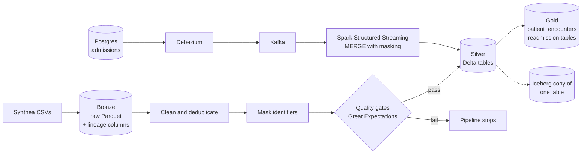

# Hospital Readmissions Lakehouse

A medallion lakehouse (bronze, silver, gold) built on synthetic hospital data. It calculates the 30-day readmission rate by department, with privacy designed in from the start, quality gates that stop bad data, and a change data capture (CDC) upgrade that ends in a Delta Lake vs Apache Iceberg comparison.

**Status:** in development. The work is planned as 17 issues over four weeks. This README describes the target design, and the sections on results and documentation are filled in as each milestone lands.

**Data:** 100 percent synthetic. All patient data comes from [Synthea](https://github.com/synthetichealth/synthea), so no real person is ever involved.

---

## Table of contents

- [Why this project](#why-this-project)
- [What it demonstrates](#what-it-demonstrates)
- [Architecture](#architecture)
- [The metric](#the-metric)
- [Privacy by design](#privacy-by-design)
- [Data quality gates](#data-quality-gates)
- [Change data capture](#change-data-capture)
- [Delta Lake vs Iceberg](#delta-lake-vs-iceberg)
- [Tech stack](#tech-stack)
- [Repository layout](#repository-layout)
- [Getting started](#getting-started)
- [Testing](#testing)
- [Roadmap](#roadmap)
- [Results](#results)
- [Documentation](#documentation)
- [Limitations](#limitations)
- [License and acknowledgments](#license-and-acknowledgments)

---

## Why this project

Healthcare data raises the stakes for data engineering. A leaked identifier exposes a person, and a wrong metric misleads decisions. Most example pipelines skip exactly these concerns. This project treats them as the main work:

- Who can see which layer is enforced by infrastructure as code, not by convention.
- Personal identifiers are removed or generalized before analysts ever see the data, and an automated test fails if one slips through.
- Bad data stops the pipeline instead of flowing into reports.
- The business metric is defined in writing and validated against hand-calculated cases.

## What it demonstrates

| Skill | Where it shows up |
|-------|-------------------|
| Lakehouse design | Bronze, silver, and gold layers on object storage |
| Infrastructure as code | Terraform bucket and three least-privilege identities |
| Privacy engineering | Salted hashing, dropped identifiers, age bands, regions, PII test |
| Data quality | Great Expectations suite that fails the run |
| Analytics engineering | 30-day readmission flag, validated with edge-case tests |
| Table formats | Delta Lake time travel and schema evolution, Iceberg rebuild and comparison |
| Streaming and CDC | Postgres, Debezium, Kafka, Spark Structured Streaming MERGE |
| Orchestration | Dagster-managed pipeline steps |

## Architecture



Storage layers and who can access them:

| Layer | Contents | Written by | Readable by |
|-------|----------|-----------|-------------|
| `bronze/` | Source data unchanged, plus `ingested_at` and `source_file` | `ingest-writer` | `engineer` |
| `silver/` | Typed, deduplicated, masked Delta tables | pipeline | `engineer`, `analyst` |
| `gold/` | Analyst-ready tables and the readmission report | pipeline | `engineer`, `analyst` |

The `analyst` identity is denied access to `bronze/`. The full policy, including how the masking salt is stored and rotated, is written in [`docs/access-policy.md`](docs/access-policy.md), and every row of it must match an actual Terraform permission.

## The metric

**30-day readmission rate by department.**

Working definition: among inpatient encounters, an admission counts as a readmission when the same patient's next admission starts within 30 days of the current discharge. The rate for a department is readmissions divided by eligible discharges.

- Next admission is found with `LEAD(start) OVER (PARTITION BY patient_key ORDER BY start)`.
- Synthea has no department field, so **provider specialty is used as a department proxy**.
- Treatment of patients who died, overlapping stays, and the exact-30-day boundary are documented in [`docs/metrics.md`](docs/metrics.md).

The metric is validated two ways: a hand calculation for five patients, and unit tests on a small fixture covering exactly 30 days, 31 days, overlapping stays, and a death.

## Privacy by design

1. **Salted hashing.** Patient ID becomes a salted SHA-256 key. The salt comes from an environment variable or secret manager and is never committed.
2. **Dropped identifiers.** Name, SSN, driver license, passport, and street address are removed.
3. **Generalization.** Birth date becomes an age band, and address becomes a region.
4. **Automated check.** A test fails if any banned column name appears in silver or gold. It is also verified to fail when a banned column is added on purpose.
5. **Same rules for streaming.** The CDC path applies the identical masking before writing to silver.

Although the data is synthetic, the controls follow how real healthcare data should be handled.

## Data quality gates

Great Expectations runs as a pipeline step and raises an error on failure. The suite checks that:

- discharge is not before admission
- age is between 0 and 120
- the patient key is not null
- encounter class is in the allowed list

A failure drill injects a bad row (discharge before admission) and confirms the run stops. A data docs report is generated for review.

## Change data capture

To practice keeping silver in sync with a live source, a Postgres `admissions` table (with `wal_level=logical`) receives a continuous mix of inserts, updates, and deletes from a change generator. Debezium publishes each change to Kafka with `before` and `after` values. Spark Structured Streaming reads the topic and, in `foreachBatch`, keeps the latest change per key and applies a Delta `MERGE`.

Target: an update in the source appears in silver within one minute.

## Delta Lake vs Iceberg

Delta Lake is used throughout. One silver table is rebuilt in Apache Iceberg, the same `MERGE` is run, and time travel and schema evolution are tested on both. The written comparison covers setup effort, features, and tool support, and is based only on what was observed. See [`docs/delta-vs-iceberg.md`](docs/delta-vs-iceberg.md).

## Tech stack

| Layer | Choice |
|-------|--------|
| Data source | Synthea (10,000 patients, fixed seed) |
| Infrastructure as code | Terraform |
| Object storage | Google Cloud Storage (local development uses a plain folder) |
| Processing | PySpark 4.0 |
| Table formats | Delta Lake 4.0, Apache Iceberg |
| Data quality | Great Expectations 1.x |
| Orchestration | Dagster |
| Source database | Postgres 16 |
| CDC | Debezium, Kafka, Kafka Connect |
| Tooling | uv, Docker Compose, pytest, ruff |

## Repository layout

```
.
├── conf/versions.env          JVM package versions (Spark, Delta, Iceberg)
├── docker/                    Postgres, Kafka, Debezium Connect
├── infra/terraform/           bucket, identities, permissions
├── scripts/                   install, bootstrap, Synthea, connector, teardown
├── src/readmissions/
│   ├── ingestion/             CSV to bronze
│   ├── silver/                clean and deduplicate
│   ├── privacy/               masking
│   ├── quality/               Great Expectations runner
│   ├── gold/                  encounters, readmission flag, daily rate
│   ├── cdc/                   change generator and streaming MERGE
│   ├── iceberg/               Iceberg rebuild
│   └── orchestration/         Dagster definitions
├── great_expectations/        expectation suites and data docs
├── tests/                     unit, integration, fixtures
├── notebooks/                 Delta time travel and schema evolution demo
└── docs/                      policy, metric, comparison, case study
```

## Getting started

### Prerequisites

- Linux or macOS. Commands below target Arch Linux (tested design target: Omarchy). Other systems need equivalent packages.
- JDK 17 or newer
- [uv](https://docs.astral.sh/uv/) (installs Python 3.12 for you)
- Docker with Compose
- Terraform and the Google Cloud CLI (only for the cloud portion)

### Install system tools (Arch Linux)

```bash
sudo pacman -Syu
./scripts/install_arch.sh
newgrp docker        # or log out and back in
```

This installs `jdk17-openjdk`, `uv`, and Docker through pacman, and `terraform`, `google-cloud-cli`, and `kcat` through yay. Full tool list and other options: [`docs/setup-and-dependencies.md`](docs/setup-and-dependencies.md).

### Set up the project

```bash
make setup                 # creates .env, installs Python 3.12 and libraries, checks tools
openssl rand -hex 32       # paste the output as PII_SALT in .env
```

### Run it

```bash
make up                    # Postgres, Kafka, Debezium
make synthea               # generate 10,000 synthetic patients into data/raw/
make dagster               # open http://localhost:3000 and materialize the pipeline
make connector             # register the Debezium connector for the CDC demo
```

Watch change events:

```bash
kcat -b localhost:29092 -t hospital.public.admissions -C -o beginning
```

The Dagster definitions are added as the ingestion work lands, so `make dagster` becomes usable after the bronze milestone.

### Run in the cloud

```bash
gcloud auth login
gcloud auth application-default login
gcloud config set project YOUR_PROJECT_ID
cd infra/terraform && terraform init && terraform apply
```

Set `LAKE_ROOT=gs://<your-bucket>` in `.env`. Set a billing budget alert before applying.

### Tear down

```bash
./scripts/teardown.sh      # stops local services and destroys cloud resources
```

Then confirm in the billing console that nothing is running.

## Testing

```bash
make test                  # unit tests (no Docker or cloud needed)
make lint                  # ruff
```

Tests cover the readmission edge cases, the PII check, and the failure drill. Tests marked `integration` need Docker services or cloud access.

## Roadmap

| Week | Milestone | Outcome |
|------|-----------|---------|
| 1 | Data and bronze layer | Synthea data generated, Spark and Delta working, Terraform roles, bronze with exact row counts |
| 2 | Silver, privacy, quality | Cleaned Delta tables, masking and PII test, quality gates, written access policy |
| 3 | Gold and analytics | Patient encounters table, validated 30-day readmission flag, daily rate table, Delta features demo |
| 4 | CDC and Iceberg | Live changes merged into silver, Iceberg comparison, failure test, case study, teardown |

## Results

Results are published here when the final milestone is complete:

- Headline 30-day readmission rate and the departments with the highest and lowest rates: to be added
- Test and quality gate summary: to be added
- Measured CDC latency from source update to silver: to be added
- Final cloud cost after teardown: to be added

## Documentation

These documents are written as the related milestones are finished.

| Document | Purpose |
|----------|---------|
| [`docs/data-profile.md`](docs/data-profile.md) | Source files and row counts |
| [`docs/access-policy.md`](docs/access-policy.md) | Who can see which layer, masking method, salt handling |
| [`docs/metrics.md`](docs/metrics.md) | Exact readmission definition and edge cases |
| [`docs/delta-vs-iceberg.md`](docs/delta-vs-iceberg.md) | Observed comparison of the two table formats |
| [`docs/setup-and-dependencies.md`](docs/setup-and-dependencies.md) | Tools, libraries, install commands, troubleshooting |
| [`docs/hospital-readmissions-lakehouse-prd.md`](docs/hospital-readmissions-lakehouse-prd.md) | Product requirements |
| `docs/case-study.md` | One-page summary with architecture and result |

## Limitations

- Synthetic data does not reproduce real clinical patterns, so the readmission rates say nothing about real hospitals.
- Department is approximated by provider specialty because Synthea has no department field.
- The project runs on a single machine (local Spark) and is not a production deployment. There are no SLAs, multi-region setup, or dashboards.
- Iceberg is evaluated on one table only, so the comparison is a small-scale observation.

## License and acknowledgments

Released under the [Unlicense](https://github.com/Menjadianjay/hospital-readmission-governance/tree/main?tab=Unlicense-1-ov-file). 

Patient data is generated with [Synthea](https://github.com/synthetichealth/synthea), an open-source synthetic patient generator.

Built by [Joseph](josephdeornay@gmail.com)
